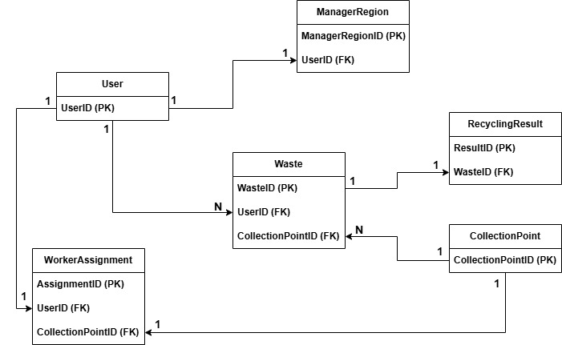
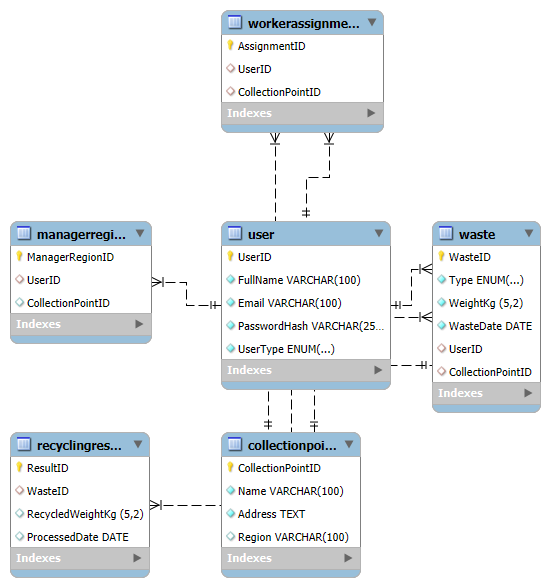

# Waste Management and Recycling System (DBMS Project)

A role-based **Waste Management and Recycling Tracking System** designed and developed as part of the graduate Database Management Systems (DBMS) coursework. Built with **MySQL**, **Python (Flask)**, and **HTML/CSS**, the system centralizes waste reporting, collection point tracking, worker assignments, and regional recycling analytics for municipalities.

---

## Key Features & Requirement Analysis

The system is architected around three distinct user roles (**Citizen**, **Worker**, and **Municipality Official**), each with dedicated dashboards and access permissions:

* **Citizen Portal:**
  * Submit new waste notifications by specifying waste type (`Plastic`, `Glass`, `Organic`, etc.), weight (`kg`), date, and collection point.
  * Track personal historical waste records alongside actual recycled amounts (`RecycledWeightKg`) via relational joins.
  * Manage account security (password updates and full account deletion with cascading data cleanup).
* **Worker Portal:**
  * View assigned collection points (`WorkerAssignment`) and monitor incoming waste records for assigned regions with paginated task lists.
* **Municipality Official (Manager) Portal:**
  * Monitor regional collection points (`ManagerRegion`), assigned workers, and all regional waste records.
  * **Privacy by Design:** Citizen identities are automatically anonymized on official/worker views to protect personal data.
  * **Decision Support Analytics:** Real-time SQL aggregation of **daily** and **monthly** total waste volumes (`kg`) across assigned regions.
  * Manage workforce assignments (remove/unassign workers from specific collection points).

---

## Database Design (ER & Relational Schema)

The relational database (`waste_management`) consists of **6 normalized tables** in **MySQL 8.0**:

1. **`User`**: Stores user credentials and role types (`UserID`, `FullName`, `Email`, `PasswordHash`, `UserType`).
2. **`CollectionPoint`**: Stores collection point locations and regions (`CollectionPointID`, `Name`, `Address`, `Region`).
3. **`Waste`**: Tracks citizen waste declarations (`WasteID`, `Type`, `WeightKg`, `WasteDate`, `UserID`, `CollectionPointID`).
4. **`RecyclingResult`**: 1-to-1 tracking of processed recycling outcomes (`ResultID`, `RecycledWeightKg`, `ProcessedDate`, `WasteID`).
5. **`WorkerAssignment`**: Maps field workers to collection points (`AssignmentID`, `UserID`, `CollectionPointID`).
6. **`ManagerRegion`**: Maps municipality officials to authorized collection points (`ManagerRegionID`, `UserID`, `CollectionPointID`).

### Entity-Relationship (E/R) Diagram


### Enhanced Entity-Relationship (EER) / Relational Schema


---

## Project Structure

```text
├── db_project/
│   ├── app.py                 # Flask application routes, role authorization & SQL queries
│   ├── db.py                  # MySQL database connection module
│   └── templates/             # Jinja2 HTML templates (index, login, register, citizen, worker, manager)
├── Drawio_ER_Yildiz.jpg       # Entity-Relationship Diagram (Draw.io)
├── EERDiagram.png             # MySQL Workbench EER Relational Schema
├── finaldump.sql              # Full MySQL 8.0 database schema and seed data dump
├── Report_YildizIsleyen.pdf   # Detailed project report (Requirement Analysis, ER Design, UI views)
└── requirements.txt           # Python dependencies
```

---

## Setup & Installation

### 1. Database Configuration (MySQL)
Import the provided SQL dump (`finaldump.sql`) into your MySQL server:
```sql
CREATE DATABASE waste_management;
USE waste_management;
SOURCE finaldump.sql;
```

### 2. Install Python Dependencies
```bash
pip install -r requirements.txt
```

### 3. Configure Environment Variables & Run
Set your MySQL credentials via environment variables (or update `db_project/db.py`):
```bash
# PowerShell
$env:DB_USER="root"
$env:DB_PASSWORD="your_password"
$env:DB_NAME="waste_management"

cd db_project
python app.py
```
Then open `http://127.0.0.1:5000` in your browser.
